<picture>
  <source media="(prefers-color-scheme: dark)" srcset="assets/header-dark.svg">
  
</picture>

  
  
  

### About

I build software from the bottom of the stack up. Through the **42** curriculum I've gone from writing C with no standard library to lean on, to hardening Linux servers, orchestrating containers, designing object-oriented Python systems, writing pathfinding algorithms, building multithreaded network services and wiring up LLM agents with retrieval. Outside the curriculum I ship small, fast web apps that keep working when the network doesn't.

- **Now:** concurrent and network programming, LLM agents and RAG pipelines, full-stack web
- **Interested in:** systems programming, Linux internals, distributed systems, applied AI, offline-first software
- **Principles:** small dependencies, measurable behaviour, code someone else can read

### Featured work

| Project | What it is | Stack |
| --- | --- | --- |
| [**Zero Bars**](https://github.com/Blitz-adali/zero-bars) · [live](https://blitz-adali.github.io/zero-bars/) | Offline-first coding course in ~130 KB. Sandboxed JS runner in a Web Worker, hand-written QR encoder for sharing challenges phone-to-phone, EN/ES/AR with RTL. | JavaScript, PWA, Service Worker |
| [**Libft**](https://github.com/Blitz-adali/Libft) | A static C library re-implementing libc string, memory and conversion routines plus a singly linked list API. | C, Make |
| [**ft_printf**](https://github.com/Blitz-adali/Printf) | `printf` from scratch: variadic argument handling, format parsing, decimal/hex/pointer conversion over raw `write(2)`. | C, Make |
| [**get_next_line**](https://github.com/Blitz-adali/get_next_line) | Line-by-line reader over any file descriptor with a static carry-over buffer and configurable `BUFFER_SIZE`. | C |
| [**Born2beRoot**](https://github.com/Blitz-adali/Born2beRoot) | Hardened Debian VM: encrypted LVM, UFW, SSH on a custom port, strict sudo and password policy, cron-driven monitoring script. | Linux, Bash |

### What I've learned

<table>
<tr><td width="50%" valign="top">

**Systems programming in C**
Libft · ft_printf · get_next_line · push_swap

Memory management & pointers · dynamic allocation · linked lists · stacks · strings & string parsing/formatting · buffered I/O · variadic functions · type conversion & representation · state management in functions · command-line argument parsing · library creation & linking · automated compilation (Make) · imperative programming

</td><td width="50%" valign="top">

**Systems & network administration**
Born2beRoot · NetPractice · Inception

OS installation · disk partitioning · virtualisation · user & group management · system hardening · firewall management · policy implementation · service & web server configuration · job scheduling · automation · IP addressing · subnetting · routing & gateways · containerization · container networking & orchestration · data persistence · secrets management · web stack deployment · troubleshooting

</td></tr>
<tr><td valign="top">

**Object-oriented design in Python**
Garden Guardian · Data Quest · Code Nexus · The Codex · DataDeck · The Matrix · FuncMage · A-Maze-ing · Pacman

Classes, attributes & methods · instances & initialisation · inheritance & initialisation chains · encapsulation · abstract classes · subtype polymorphism · function overriding · nested classes · scope & locality · component conception · modularity & code organisation · data manipulation & visualisation · functional programming · game development

</td><td valign="top">

**Algorithms**
push_swap · Fly-in

Sorting · complexity analysis · algorithmic strategy · graph traversal · multi-agent pathfinding · system simulation & performance optimisation

</td></tr>
<tr><td valign="top">

**Concurrent & network programming**
Codexion · The Answer Protocol

Multithreading · synchronization primitives · scheduling · resource management & starvation prevention · asynchronous programming · socket programming · client–server architecture · protocol design & implementation · data serialization

</td><td valign="top">

**Applied AI & LLMs**
call_me_maybe · RAG against the machine · Agent Smith

Prompt engineering · chain of thought · structured data generation · LLM code generation · LLM planning strategies · agentic pipelines · tool integration · feedback loops & self-correction · retrieval-augmented generation · document & embedding retrieval · chunking · re-ranking · corpus management · data extraction · text generation & sampling · system evaluation

</td></tr>
<tr><td colspan="2" valign="top">

**Full-stack web**
ft_transcendence

Web fundamentals · front-end development · single-page applications · back-end development · API design & integration · data modelling & schema design · database querying · authentication & authorization · application security · real-time communication · declarative programming · packaging & deployment

</td></tr>
</table>

### Toolbox

### Activity

<picture>
  <source media="(prefers-color-scheme: dark)" srcset="https://raw.githubusercontent.com/Blitz-adali/Blitz-adali/output/snake-dark.svg">
  
</picture>

Open to internships, collaborations and hackathon teams — reach me through GitHub.
